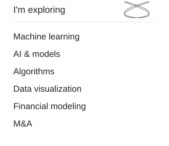

  <picture>
    <source media="(prefers-reduced-motion: reduce) and (prefers-color-scheme: dark)" srcset="assets/gooey-dark-still.svg" />
    <source media="(prefers-reduced-motion: reduce)" srcset="assets/gooey-light-still.svg" />
    <source media="(prefers-color-scheme: dark)" srcset="assets/gooey-dark.svg" />
    
  </picture>

<h3 align="center">luzdeguada</h3>

  <picture>
    <source media="(prefers-reduced-motion: reduce) and (prefers-color-scheme: dark)" srcset="assets/stack-dark-still.svg" />
    <source media="(prefers-reduced-motion: reduce)" srcset="assets/stack-light-still.svg" />
    <source media="(prefers-color-scheme: dark)" srcset="assets/stack-dark.svg" />
    
  </picture>
  <picture>
    <source media="(prefers-color-scheme: dark)" srcset="assets/exploring-dark.svg" />
    
  </picture>

 

<!-- ACTIVITY:START -->

  <picture>
    <source media="(max-width: 600px) and (prefers-reduced-motion: reduce) and (prefers-color-scheme: dark)" srcset="assets/activity-mobile-dark-still.svg" />
    <source media="(max-width: 600px) and (prefers-reduced-motion: reduce)" srcset="assets/activity-mobile-light-still.svg" />
    <source media="(prefers-reduced-motion: reduce) and (prefers-color-scheme: dark)" srcset="assets/activity-dark-still.svg" />
    <source media="(prefers-reduced-motion: reduce)" srcset="assets/activity-light-still.svg" />
    <source media="(max-width: 600px) and (prefers-color-scheme: dark)" srcset="assets/activity-mobile-dark.svg" />
    <source media="(max-width: 600px)" srcset="assets/activity-mobile-light.svg" />
    <source media="(prefers-color-scheme: dark)" srcset="assets/activity-dark.svg" />
    
  </picture>

<!-- ACTIVITY:END -->

<a href="https://github.com/dfoucaul?tab=overview">View activity</a>

