  <picture>
    <source media="(prefers-reduced-motion: reduce) and (prefers-color-scheme: dark)" srcset="assets/gooey-dark-still.svg" />
    <source media="(prefers-reduced-motion: reduce)" srcset="assets/gooey-light-still.svg" />
    <source media="(prefers-color-scheme: dark)" srcset="assets/gooey-dark.svg" />
    
  </picture>

<h3 align="center">luzdeguada</h3>

Rust &nbsp;·&nbsp; Go &nbsp;·&nbsp; TypeScript &nbsp;·&nbsp; Python

Machine learning &nbsp;·&nbsp; IA &nbsp;·&nbsp; Algorithmes &nbsp;·&nbsp; Data

 

<!-- ACTIVITY:START -->

  <strong>8 873 contributions</strong> 
  Sur les douze derniers mois, activité privée incluse.

<!-- ACTIVITY:END -->

<a href="https://github.com/dfoucaul?tab=overview">Voir mon activité</a>

