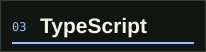
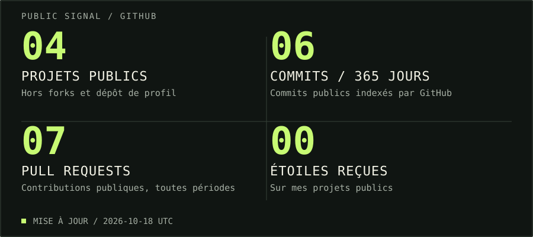

  

  <a href="#mes-langages">LANGAGES</a> &nbsp; / &nbsp;
  <a href="#ce-qui-mintéresse">ML &amp; DATA</a> &nbsp; / &nbsp;
  <a href="#quelques-projets">PROJETS</a> &nbsp; / &nbsp;
  <a href="#côté-github">STATS</a>

 

### Salut, moi c’est luzdeguada.

J’aime explorer les idées par le code : des langages système aux applications web, des algorithmes au machine learning.

**Construire. Comprendre. Expérimenter. Recommencer.**

 

01 / THE TOOLBOX

### Mes langages

  
  
  
  

 

02 / THE RABBIT HOLE

### Ce qui m’intéresse

**Machine learning & IA** &nbsp;·&nbsp; Modèles, données et expérimentation.

**Algorithmes & résolution de problèmes** &nbsp;·&nbsp; Décomposer, tester, comprendre.

**Visualisation de données** &nbsp;·&nbsp; Rendre les résultats lisibles.

 

03 / IN THE WORKSHOP

### Quelques projets

| Projet | Terrain de jeu |
| :--- | :--- |
| **[MLProject](https://github.com/dfoucaul/MLProject)** | Machine learning |
| **[Sudoku_solver](https://github.com/dfoucaul/Sudoku_solver)** | Algorithmes · Résolution de Sudoku |
| **[SetSketch](https://github.com/dfoucaul/SetSketch)** | Notebooks · Expérimentations |
| **[Power BI / Viz](https://github.com/dfoucaul/7_PowerBI_Viz)** | Données · Visualisation |

 

04 / THE NUMBERS

### Côté GitHub

  

Lire les statistiques

Les chiffres concernent mon activité **publique**. Les commits couvrent les 365 derniers jours et sont comptés par la recherche GitHub ; ils peuvent différer du calendrier de contributions. Les pull requests couvrent toute la période. Les projets excluent les forks et ce dépôt de profil. Les étoiles sont celles de ces projets.

 

---

  ART MEETS CODE. &nbsp; / &nbsp; Une question sur un projet ? On en parle dans ses issues.

