  <picture>
    <source media="(max-width: 600px) and (prefers-reduced-motion: reduce) and (prefers-color-scheme: dark)" srcset="assets/header-mobile-dark-still.svg?v=instrument-serif-luz-de-guada" />
    <source media="(max-width: 600px) and (prefers-reduced-motion: reduce)" srcset="assets/header-mobile-light-still.svg?v=instrument-serif-luz-de-guada" />
    <source media="(prefers-reduced-motion: reduce) and (prefers-color-scheme: dark)" srcset="assets/header-dark-still.svg?v=instrument-serif-luz-de-guada" />
    <source media="(prefers-reduced-motion: reduce)" srcset="assets/header-light-still.svg?v=instrument-serif-luz-de-guada" />
    <source media="(max-width: 600px) and (prefers-color-scheme: dark)" srcset="assets/header-mobile-dark.svg?v=instrument-serif-luz-de-guada" />
    <source media="(max-width: 600px)" srcset="assets/header-mobile-light.svg?v=instrument-serif-luz-de-guada" />
    <source media="(prefers-color-scheme: dark)" srcset="assets/header-dark.svg?v=instrument-serif-luz-de-guada" />
    
  </picture>

  <a href="https://shredeo.com/">
    <picture>
      <source media="(max-width: 600px) and (prefers-reduced-motion: reduce) and (prefers-color-scheme: dark)" srcset="assets/company-shredeo-mobile-dark-still.svg" />
      <source media="(max-width: 600px) and (prefers-reduced-motion: reduce)" srcset="assets/company-shredeo-mobile-light-still.svg" />
      <source media="(prefers-reduced-motion: reduce) and (prefers-color-scheme: dark)" srcset="assets/company-shredeo-dark-still.svg" />
      <source media="(prefers-reduced-motion: reduce)" srcset="assets/company-shredeo-light-still.svg" />
      <source media="(max-width: 600px) and (prefers-color-scheme: dark)" srcset="assets/company-shredeo-mobile-dark.svg" />
      <source media="(max-width: 600px)" srcset="assets/company-shredeo-mobile-light.svg" />
      <source media="(prefers-color-scheme: dark)" srcset="assets/company-shredeo-dark.svg" />
      
    </picture>
  </a>

  <a href="https://shredeo.com/">shredeo.com ↗</a> &nbsp;·&nbsp; <a href="mailto:foucauld@shredeo.com">foucauld@shredeo.com</a>

  <a href="https://prometheus-vision.com/en">
    <picture>
      <source media="(max-width: 600px) and (prefers-reduced-motion: reduce) and (prefers-color-scheme: dark)" srcset="assets/company-prometheus-vision-mobile-dark-still.svg" />
      <source media="(max-width: 600px) and (prefers-reduced-motion: reduce)" srcset="assets/company-prometheus-vision-mobile-light-still.svg" />
      <source media="(prefers-reduced-motion: reduce) and (prefers-color-scheme: dark)" srcset="assets/company-prometheus-vision-dark-still.svg" />
      <source media="(prefers-reduced-motion: reduce)" srcset="assets/company-prometheus-vision-light-still.svg" />
      <source media="(max-width: 600px) and (prefers-color-scheme: dark)" srcset="assets/company-prometheus-vision-mobile-dark.svg" />
      <source media="(max-width: 600px)" srcset="assets/company-prometheus-vision-mobile-light.svg" />
      <source media="(prefers-color-scheme: dark)" srcset="assets/company-prometheus-vision-dark.svg" />
      
    </picture>
  </a>

  <a href="https://prometheus-vision.com/en">prometheus-vision.com ↗</a> &nbsp;·&nbsp; <a href="mailto:fdelahaye@prometheus-vision.com">fdelahaye@prometheus-vision.com</a>

