  <picture>
    <source media="(max-width: 600px) and (prefers-reduced-motion: reduce) and (prefers-color-scheme: dark)" srcset="assets/header-mobile-dark-still.svg?v=instrument-serif-luz-de-guada" />
    <source media="(max-width: 600px) and (prefers-reduced-motion: reduce)" srcset="assets/header-mobile-light-still.svg?v=instrument-serif-luz-de-guada" />
    <source media="(prefers-reduced-motion: reduce) and (prefers-color-scheme: dark)" srcset="assets/header-dark-still.svg?v=instrument-serif-luz-de-guada" />
    <source media="(prefers-reduced-motion: reduce)" srcset="assets/header-light-still.svg?v=instrument-serif-luz-de-guada" />
    <source media="(max-width: 600px) and (prefers-color-scheme: dark)" srcset="assets/header-mobile-dark.svg?v=instrument-serif-luz-de-guada" />
    <source media="(max-width: 600px)" srcset="assets/header-mobile-light.svg?v=instrument-serif-luz-de-guada" />
    <source media="(prefers-color-scheme: dark)" srcset="assets/header-dark.svg?v=instrument-serif-luz-de-guada" />
    
  </picture>

 

<!-- ACTIVITY:START -->

  <a href="https://raw.githubusercontent.com/dfoucaul/dfoucaul/main/assets/activity-interactive.svg" title="Open the interactive chart">
  <picture>
    <source media="(max-width: 600px) and (prefers-reduced-motion: reduce) and (prefers-color-scheme: dark)" srcset="assets/activity-mobile-dark-still.svg" />
    <source media="(max-width: 600px) and (prefers-reduced-motion: reduce)" srcset="assets/activity-mobile-light-still.svg" />
    <source media="(prefers-reduced-motion: reduce) and (prefers-color-scheme: dark)" srcset="assets/activity-dark-still.svg" />
    <source media="(prefers-reduced-motion: reduce)" srcset="assets/activity-light-still.svg" />
    <source media="(max-width: 600px) and (prefers-color-scheme: dark)" srcset="assets/activity-mobile-dark.svg" />
    <source media="(max-width: 600px)" srcset="assets/activity-mobile-light.svg" />
    <source media="(prefers-color-scheme: dark)" srcset="assets/activity-dark.svg" />
    
  </picture>
  </a>

<!-- ACTIVITY:END -->

<a href="https://raw.githubusercontent.com/dfoucaul/dfoucaul/main/assets/activity-interactive.svg">Explore weekly activity ↗</a>

